# Rapport de Projet : Système Microservices E-Commerce (ecom-ms-app)

## 1. Introduction

Ce projet s'inscrit dans le cadre du développement d'une architecture logicielle moderne basée sur des **microservices** avec Java, Spring Boot et Spring Cloud. L'objectif principal est de concevoir un système e-commerce distribué, évolutif, résilient et tolérant aux pannes, permettant de gérer de manière indépendante les clients, le catalogue de produits et la facturation.

Les principales réalisations de ce projet comprennent :
- Le développement des microservices métiers (`Customer-Service`, `Inventory-Service` et `Billing-Service`).
- La mise en place de l'infrastructure centralisée comprenant l'annuaire de découverte (`Discovery-Service` / Eureka Server) et la passerelle d'accès unique (`Spring Cloud Gateway`).
- La configuration du système de routage statique et dynamique à travers la Gateway.
- L'établissement d'une communication inter-services synchrone et déclarative à l'aide de **Spring Cloud OpenFeign**.
- L'implémentation des mécanismes de résilience et de tolérance aux pannes avec **Resilience4J** (Circuit Breaker et méthodes Fallback) pour éviter les pannes en cascade.
- La validation globale de l'écosystème à travers des tests d'intégration et la consultation des endpoints REST via la Gateway.

---

## 2. Architecture du Projet

L'architecture globale du système repose sur un écosystème de microservices Spring Boot communiquant entre eux et gérés par une infrastructure centralisée :

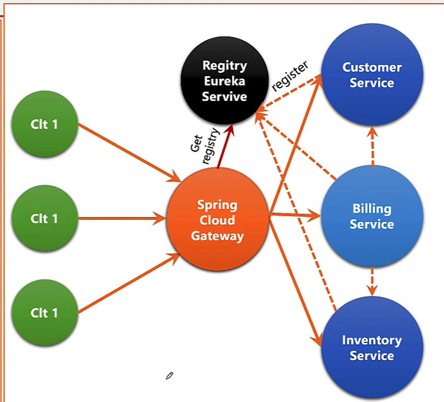

---

## 3. Implémentation et Validation des Services

### A. Discovery Service (Eureka Server - Port 8761)
Le serveur d'enregistrement et de découverte permet à l'ensemble des microservices (`CUSTOMER-SERVICE`, `INVENTORY-SERVICE` et `GATEWAY-SERVICE`) de s'enregistrer dynamiquement sans configuration d'adresses IP statiques.

- **Tableau de bord Eureka** :
  La capture ci-dessous montre l'enregistrement réussi de tous nos services avec le statut **UP**.

  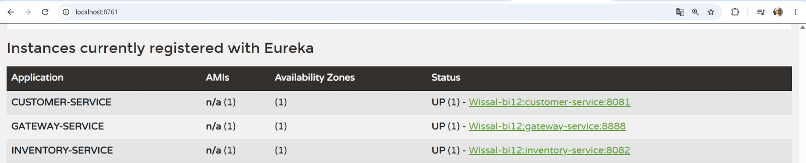

---

### B. Customer-Service (Port 8081)
Ce service gère les opérations relatives aux clients de l'application e-commerce.

- **Base de données H2 (Table CUSTOMER)** :
  Vérification de l'insertion des clients en base de données H2.

  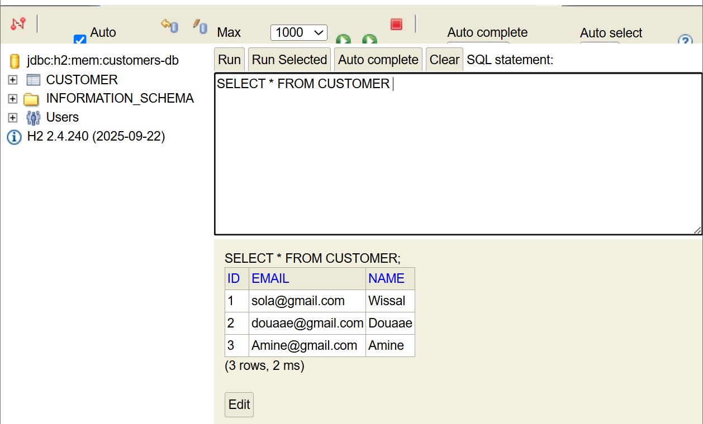

- **Liste des clients au format JSON (GET /customers)** :
  Accès direct à la liste des clients enregistrés.

  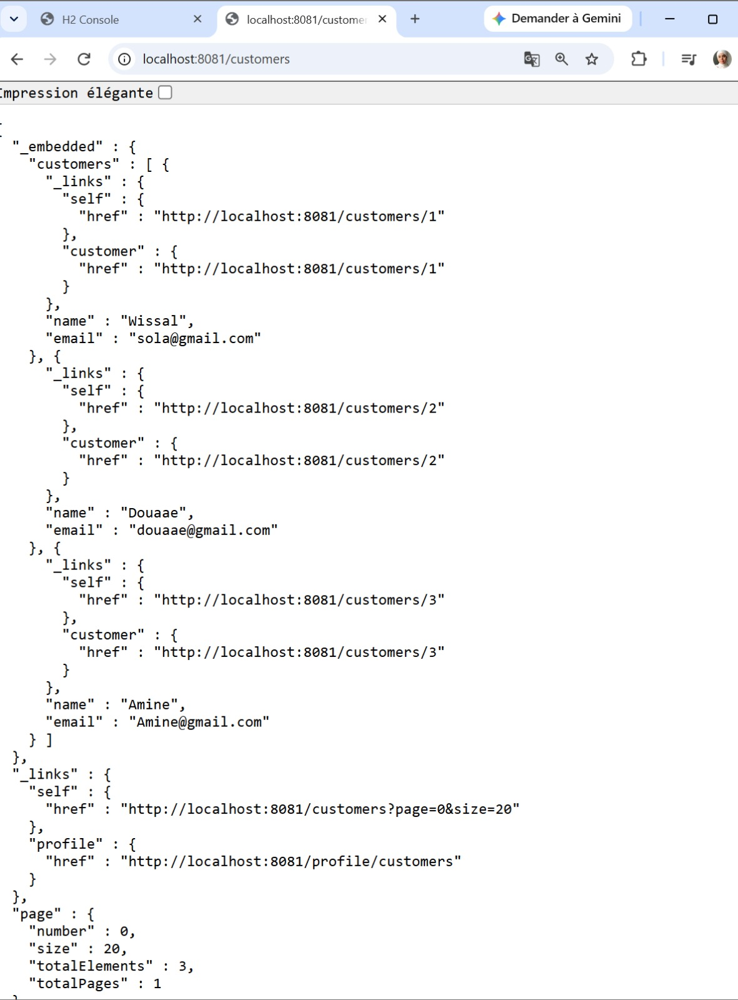

- **Recherche d'un client par ID (GET /customers/1)** :
  Récupération des détails d'un client spécifique (ID 1 - Wissal).

  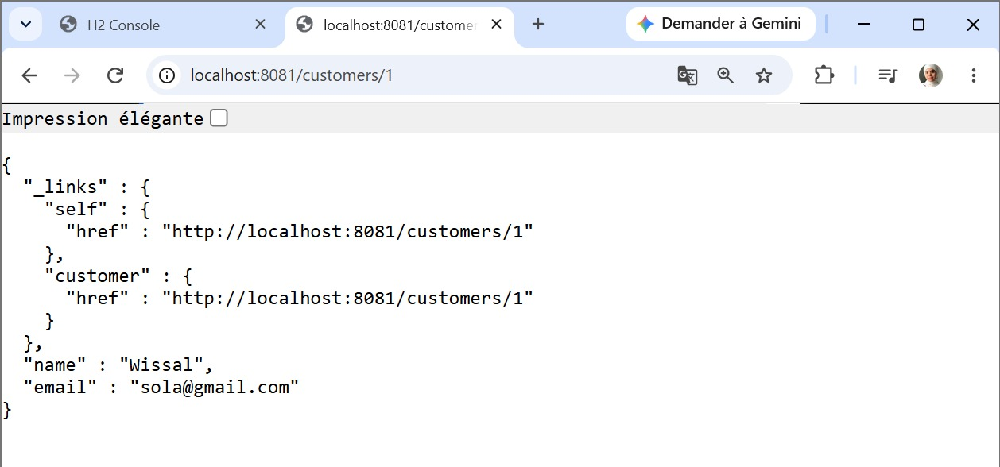

---

### C. Inventory-Service (Port 8082)
Ce service gère le catalogue et l'inventaire des produits.

- **Base de données H2 (Table PRODUCT)** :
  Affichage des produits enregistrés (Computer, Printer, Smart Phone).

  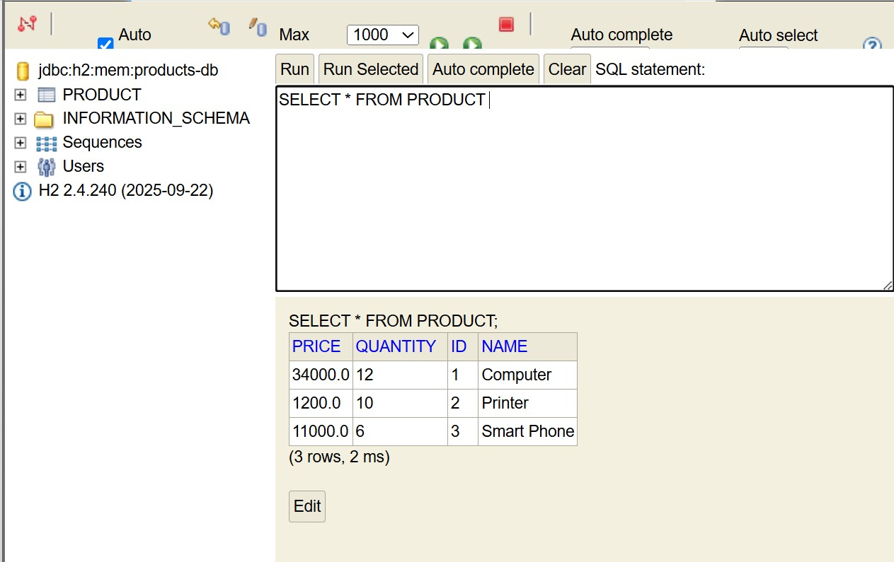

- **Liste des produits au format JSON (GET /products)** :
  Accès direct à la liste des produits du catalogue.

  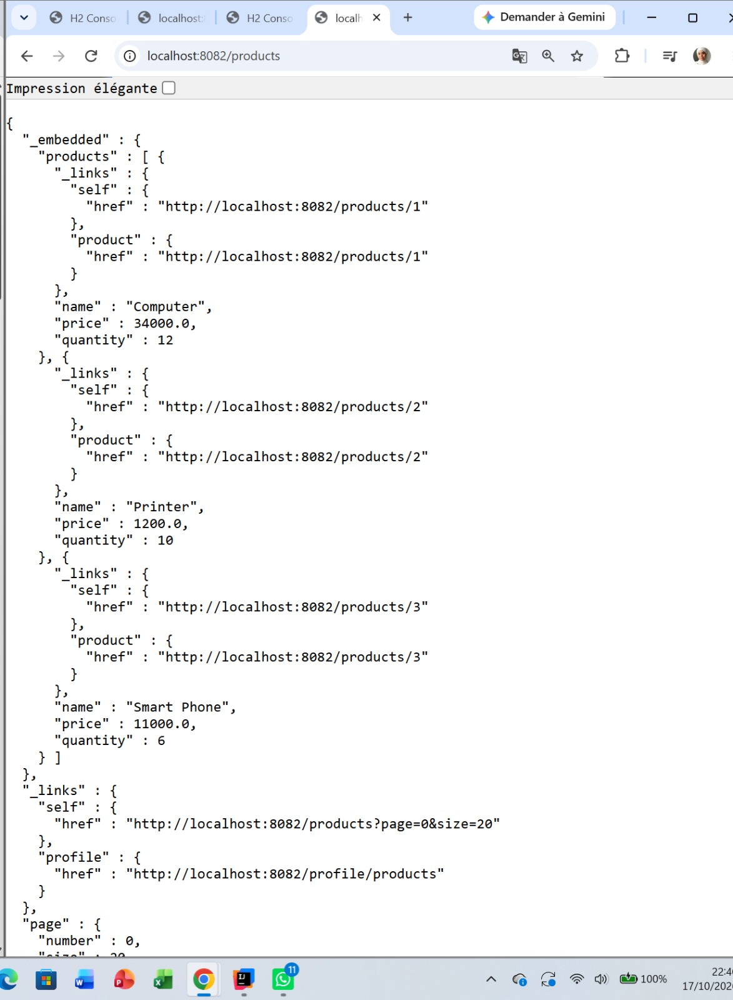

- **Recherche d'un produit par ID (GET /products/1)** :
  Récupération des informations du produit ID 1 (Computer).

  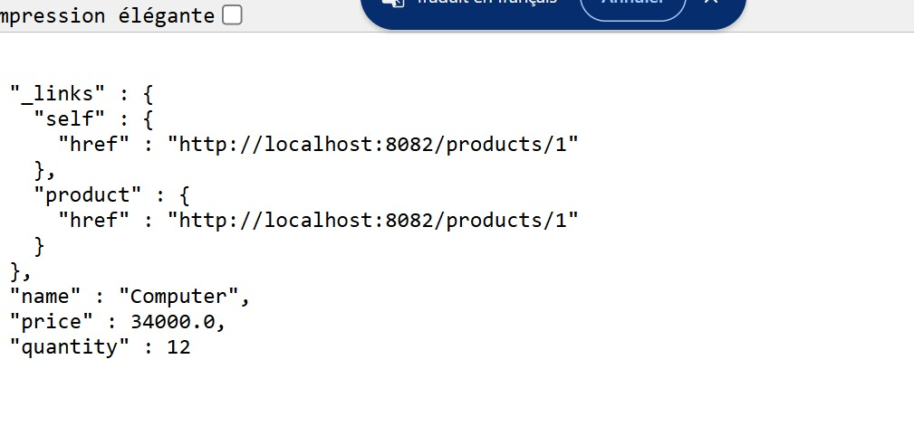

---

### D. Spring Cloud Gateway & Configuration du Routage (Port 8888)

La passerelle d'API sert de point d'entrée unique pour toutes les requêtes clients. Nous avons configuré et testé deux modes de routage :

#### 1. Configuration du Routage Statique
Redirection directe des requêtes vers les URIs physiques des microservices via le port de la Gateway (`8888`).

- **Accès aux clients via la Gateway (`http://localhost:8888/customers`)** :
  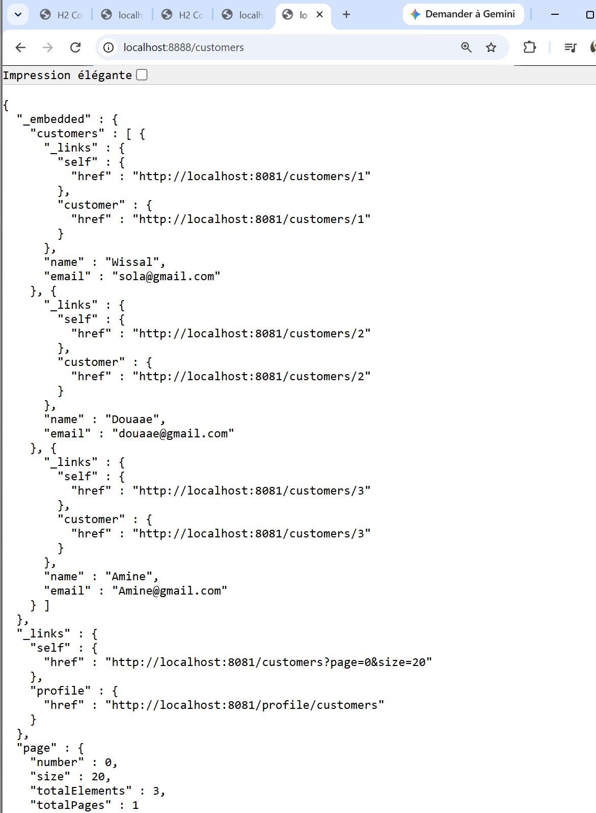

- **Accès aux produits via la Gateway (`http://localhost:8888/products`)** :
  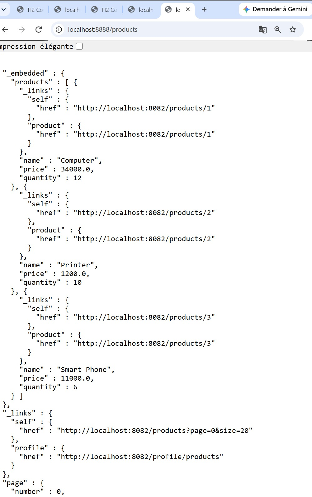

- **Accès à un produit spécifique via la Gateway (`http://localhost:8888/products/1`)** :
  

#### 2. Configuration du Routage Dynamique
Routage automatique en utilisant le nom du service enregistré dans le serveur de découverte Eureka.

- **Accès via nom du service Inventory (`http://localhost:8888/INVENTORY-SERVICE/products`)** :
  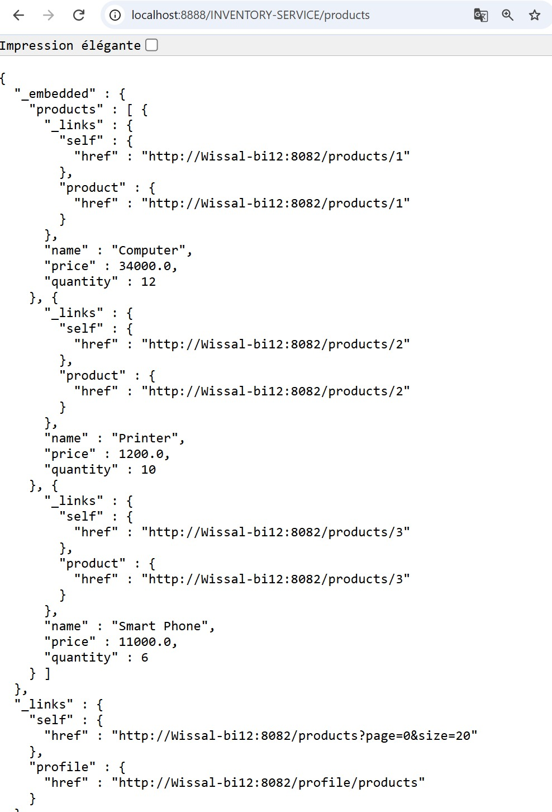

- **Accès via nom du service Customer (`http://localhost:8888/CUSTOMER-SERVICE/customers/1`)** :
  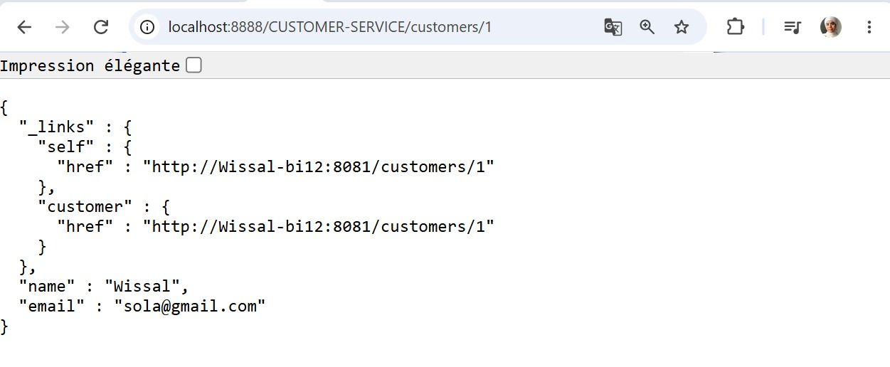

---

## 4. Implémentation du Billing-Service & Communication OpenFeign (Port 8083)

Le microservice **`Billing-Service`** est responsable de la gestion des factures (`Bill`) et des articles facturés (`ProductItem`). Il communique de manière transparente avec `Customer-Service` et `Inventory-Service` grâce à des clients déclaratifs **OpenFeign**.

---

### A. Architecture globale du système avec Billing-Service
L'architecture intègre désormais le `Billing-Service` interconnecté avec les bases de données et le Config Server centralisé :

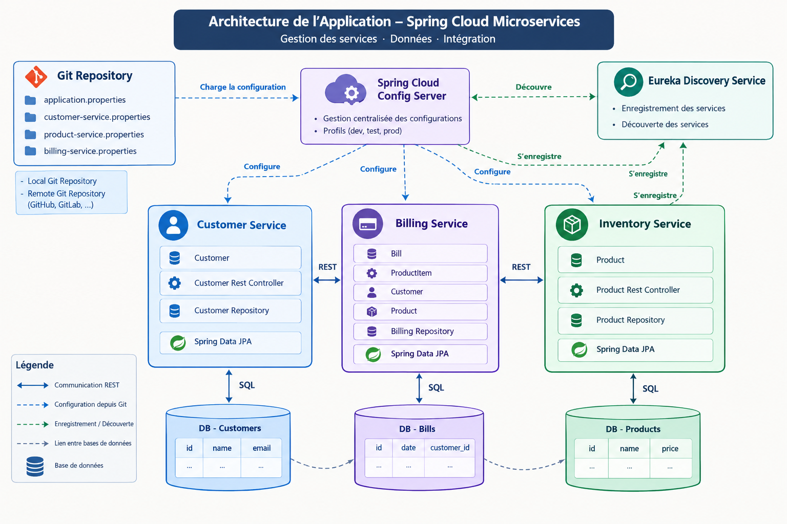

---

### B. Persistance des Factures et des Éléments Facturés (Base de données H2 - Port 8083)

- **Table BILL** :
  Affichage des factures générées associées aux identifiants clients (`CUSTOMER_ID`).

  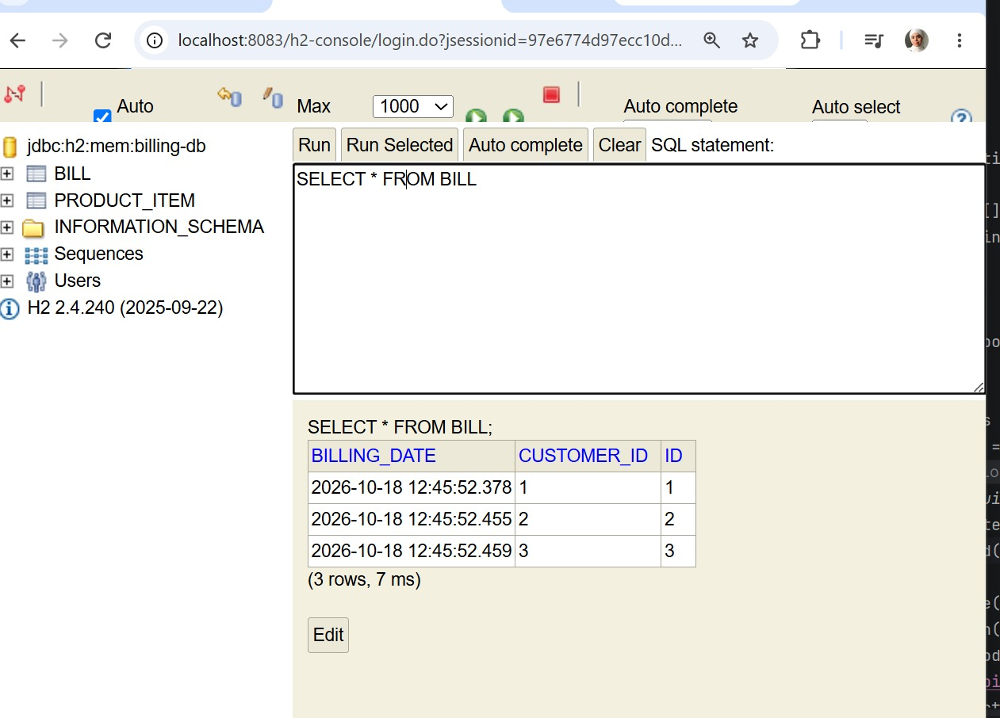

- **Table PRODUCT_ITEM** :
  Affichage des lignes de facturation contenant la quantité, le prix calculé, l'ID de la facture (`BILL_ID`) et l'ID du produit (`PRODUCT_ID`).

  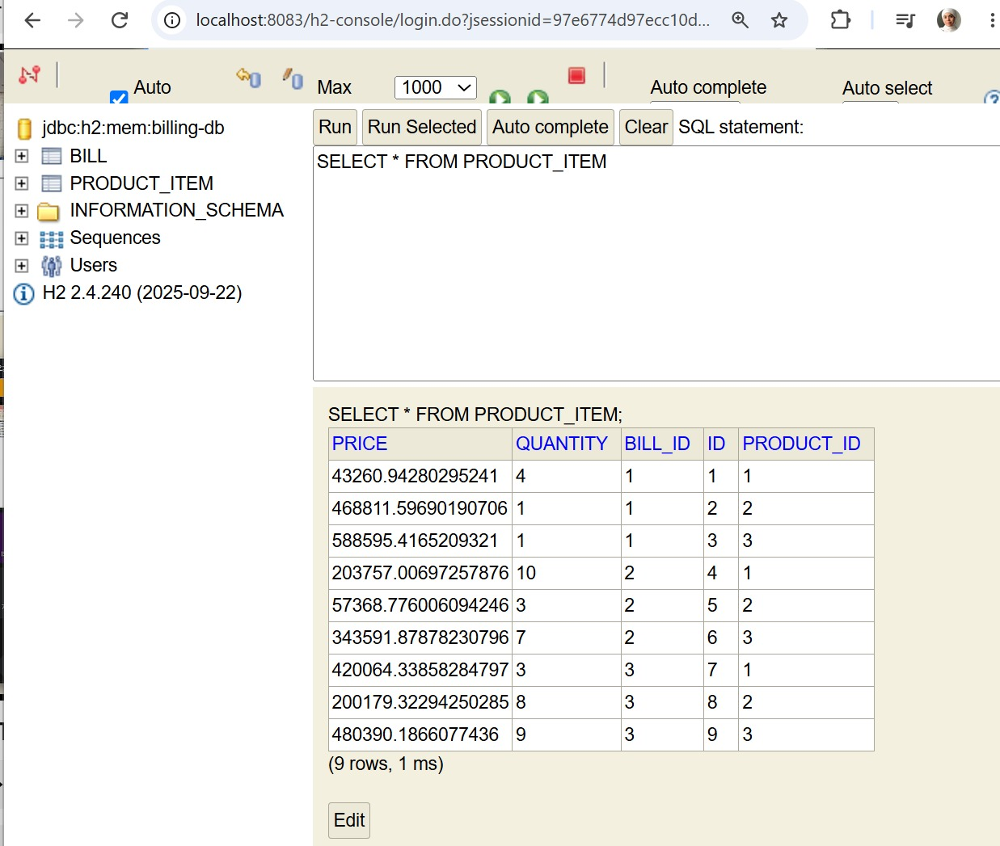

---

### C. Validation de l'API Billing-Service

- **Consulter une facture complète (GET /api/bills/1 - Directement sur Port 8083)** :
  L'API réclame les données relatives au client (ID 1) et aux produits associés via OpenFeign pour reconstituer l'objet JSON complet.

  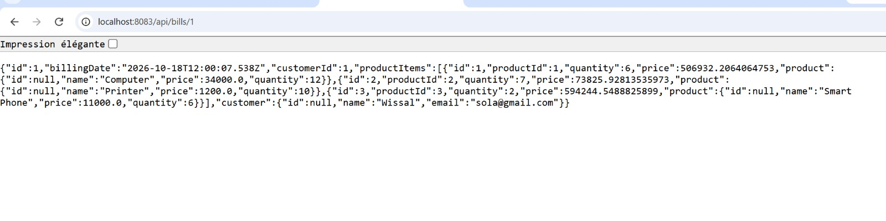

- **Consulter une facture via la Gateway (GET `http://localhost:8888/BILLING-SERVICE/api/bills/1`)** :
  Accès centralisé à la facture complète à travers la passerelle Spring Cloud Gateway.

  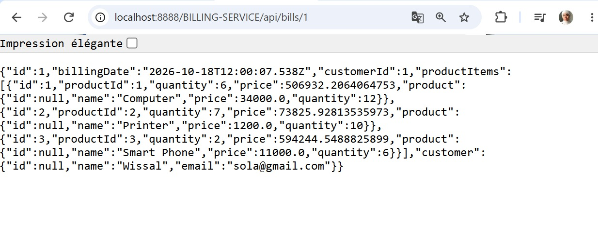

---

## 5. Tolérance aux Pannes et Résilience avec Resilience4J

Pour éviter l'effet de cascade en cas de panne d'un microservice tiers (`Customer-Service` ou `Inventory-Service`), nous avons protégé les appels OpenFeign en utilisant l'annotation `@CircuitBreaker` de **Resilience4J** :

- **Cas de panne du Customer-Service** :
  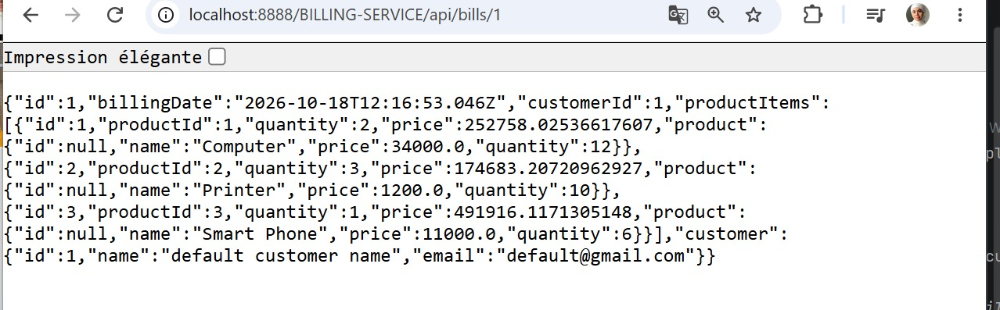

- **Cas de panne du Inventory-Service** :
  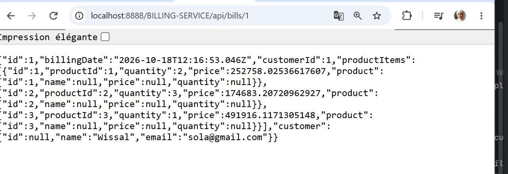

### Code d'implémentation du Circuit Breaker :

```java
@CircuitBreaker(name = "customer-service", fallbackMethod = "getDefaultCustomer")
public Customer getCustomer(Long id);

@CircuitBreaker(name = "inventory-service", fallbackMethod = "getDefaultProduct")
public Product getProduct(Long id);
````


---

## 6.Créer le service de configuration
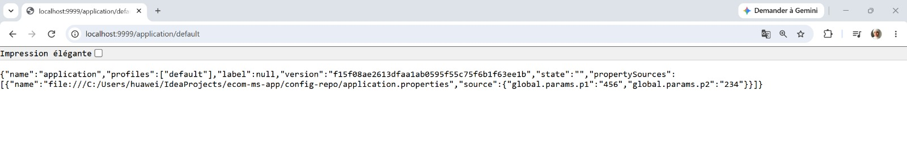
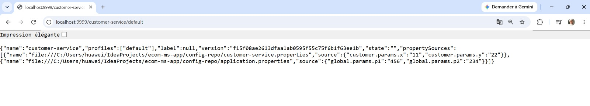
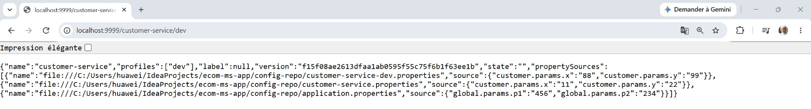
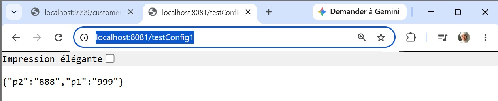
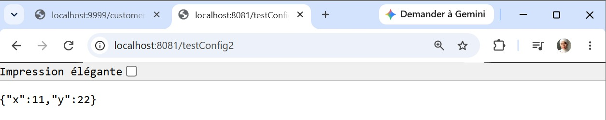

## 7. Conclusion


Ce projet a permis de valider avec succès la mise en place d'une architecture distribuée complète et robuste basée sur l'écosystème **Spring Boot** et **Spring Cloud**.

La séparation stricte des responsabilités métiers (`Customer-Service`, `Inventory-Service` et `Billing-Service`), associée au registre de découverte **Eureka** et à la passerelle **Spring Cloud Gateway**, garantit une grande extensibilité et une centralisation efficace du routage.

De plus, l'utilisation de **Spring Cloud OpenFeign** a simplifié la communication inter-services, tandis que l'intégration des Circuit Breakers avec **Resilience4J** a permis d'assurer la haute disponibilité du système grâce à des réponses dégradées (*Fallback*) en cas d'indisponibilité d'un composant. L'ensemble de cette infrastructure constitue une base solide, moderne et prête pour un déploiement en environnement de production.